

  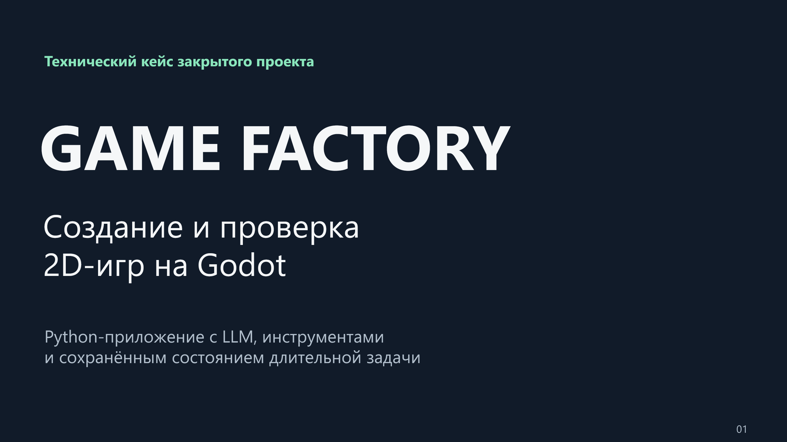

# Game Factory

**Python-приложение для создания небольших 2D-игр на Godot с помощью LLM: от текстового запроса до проекта, проверок и локальной Web-сборки.**

Game Factory управляет длительной задачей, в которой модель работает с реальным игровым проектом. Фабрика подбирает контекст, ограничивает инструментальные действия, собирает сцены, проверяет поведение и сохраняет состояние для продолжения. Отчёты связываются с конкретной версией исходников и выпущенным архивом.

LLM здесь означает большую языковую модель. Её ответ становится предложением для следующего шага: выполнить разрешённый инструмент, собрать композицию или исправить выявленную ошибку. Решение о приёме изменения опирается на предусмотренные проверки фабрики. Пользователь получает как пригодные результаты, так и объяснение оставшейся работы.

Здесь опубликован технический кейс закрытого проекта: описание, схемы, реальные снимки интерфейса и презентация.

[Презентация PDF](presentation/Game-Factory-v4.pdf) · [Архитектура](docs/ARCHITECTURE.md) · [Алгоритмы](docs/ALGORITHMS.md) · [Проверки и методика](docs/VALIDATION.md)

## Приложение и полученные игры

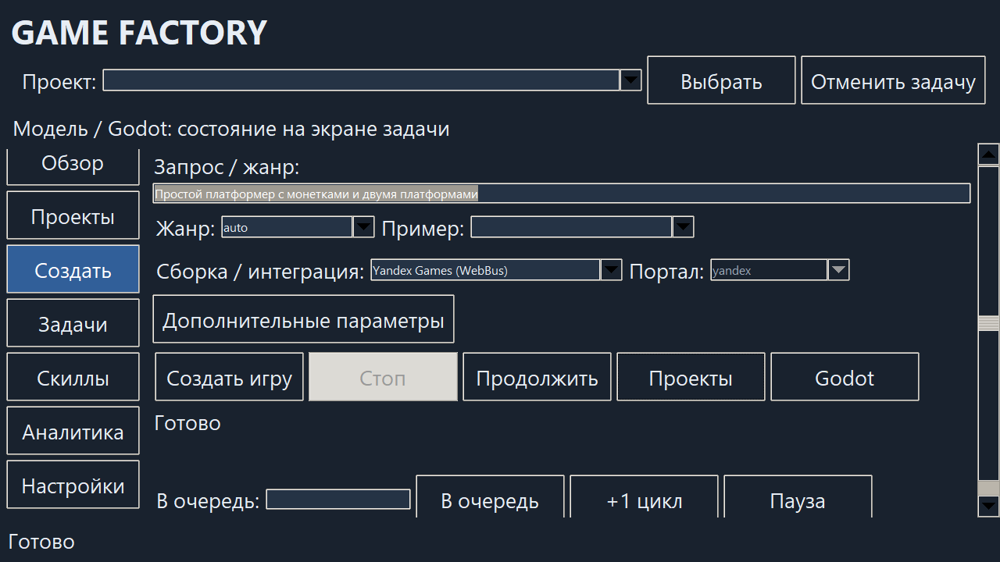

На реальном экране приложения пользователь задаёт запрос, жанр и профиль сборки, запускает работу или продолжает существующий проект. Другие разделы открывают задачи, наборы действий, историю и аналитику. Снимок получен при увеличенном масштабе Tk.

| «Мастерская» | «Три ключа» |
| --- | --- |
| 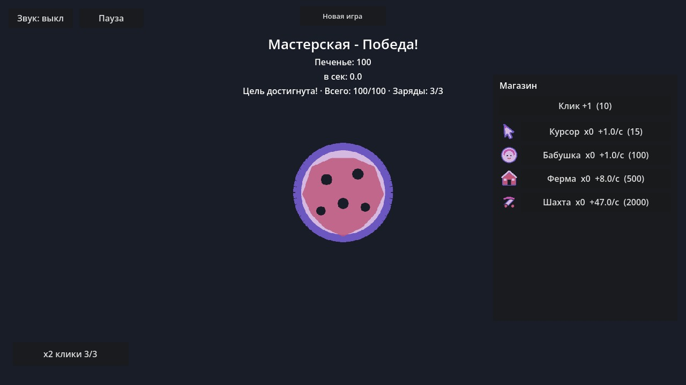 | 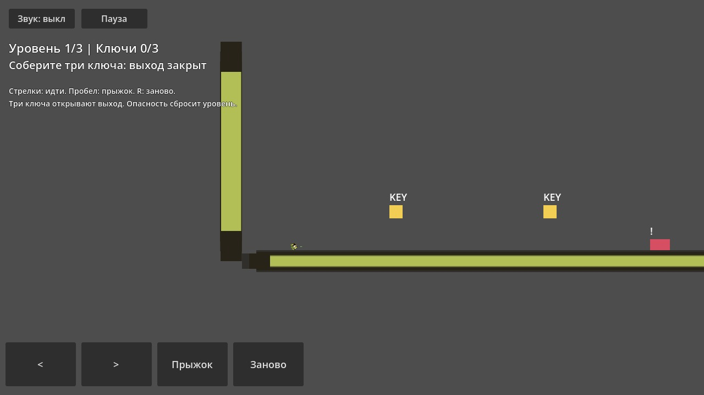 |
| Кликер с экономикой, пассивным доходом, временным усилением и сохранениями. | Платформер с тремя уровнями, ключами, закрытыми выходами и перезапуском. |

Это технические игровые прототипы из локальной серии приёмки **19 октября 2026 года**. Модельные запросы в серии обслуживал ассистент через штатные механизмы фабрики: далее такой маршрут называется **assisted**. Результаты показывают работу этой цепочки. Общая надёжность самостоятельной модели на новых запросах не измерена.

### Подтверждённые результаты

| Результат | Что именно подтверждено |
| --- | --- |
| **«Мастерская»: 92 шага × 3 размера экрана** | В принятом A10 проверены экономика, усилитель, reload, сброс и повторная победа. История включает исправления и продолжения. |
| **«Три ключа»: 47 шагов на desktop** | Пройдена полная кампания. Мобильный сценарий ограничен 16 шагами до первого выхода и сбросом в двух ориентациях. |
| **3 586 успешных тестов, 22 пропуска** | Один архивный регрессионный прогон 23 октября: всего 3 608 тестов, без падений и ошибок. Он предшествует части последующих изменений. |
| **946,47 мс / 65,49 мс** | Медианы холодного разбора и прогретого кэша навыков на одинаковых 18 запросах. Измерение относится к подбору контекста. |
| **2 506,66 мс / 24,13 мс** | Медианное суммарное время 25 повторных сводок до и после изменения аналитики на одинаковой синтетической истории. |

В игровых случаях техническое разрешение выпуска `can_ship=true` сосуществует с `ship_gate=CONCERNS` в отдельной проверке готовности. QA означает проверки качества, а SDK — средства интеграции площадки. Реальные SDK, модерация и публикация имеют отдельный неподтверждённый статус. Время компонентов не описывает скорость генерации или FPS игры. [Область доказательств и методика](docs/VALIDATION.md).

## Навигация

- [Задача и пользовательский сценарий](#задача-и-пользовательский-сценарий)
- [Возможности и стек](#возможности-и-стек)
- [Архитектура](#архитектура)
- [Конвейер и маршруты генерации](#конвейер-и-маршруты-генерации)
- [LLM, инструменты и контекст](#llm-инструменты-и-контекст)
- [Согласованность проекта](#согласованность-проекта)
- [Качество и игровые кейсы](#качество-и-игровые-кейсы)
- [Инженерные решения и зрелость](#инженерные-решения-и-зрелость)
- [Подробная документация](#подробная-документация)

## Задача и пользовательский сценарий

Исходная цель проекта — создавать небольшие игры для Яндекс Игр при ограниченных ресурсах модели. Сложность возникает после первого ответа LLM: файлы должны согласоваться, ресурсы загружаться в движок, сцены связываться, а правила игры выполняться. Последующая правка может сделать старую проверку неприменимой к новой сборке.

Фабрика распределяет работу по стадиям, использует компоненты и сохраняет промежуточные результаты. Пользователь видит состояние задачи и причину остановки. Продолжение начинается с проверки того, какие результаты ещё соответствуют текущему проекту. Работа с менее мощными моделями остаётся целью проектирования; независимого сравнения моделей в этом кейсе нет.

1. **Описание игры.** Пользователь задаёт идею, жанр и профиль сборки. Например, кликер с ограниченным усилителем или платформер с ключами и закрытым выходом.
2. **Подготовка.** Фабрика проверяет необходимые зависимости и модельный маршрут. Анализ и дизайн фиксируют механики, а поддерживаемые маршруты получают наблюдаемые критерии приёмки.
3. **Создание проекта.** Жанровая основа и рецепт определяют входы сборки. Модель предлагает структуру или правки в пределах выбранного маршрута.
4. **Проверка.** Диагностика оценивает файлы, запуск и игровые действия. Ошибка поступает в ограниченный цикл исправлений.
5. **Завершение или остановка.** Фабрика сохраняет отчёты, состояние и доступные результаты. Исчерпание бюджета оставляет явную незавершённую задачу.
6. **Дальнейшая работа.** Пользователь продолжает задачу, меняет игру через чат, сравнивает версии или выполняет отдельную операцию рабочего центра. Поддерживаемый Web-маршрут проверяет выпущенный архив в браузере.

Локальный экспорт и публикация на площадке являются разными операциями. Наличие архива ещё не подтверждает прохождение внешней приёмки.

## Возможности и стек

| Технология или механизм | Задача в системе |
| --- | --- |
| Python, Tkinter, CLI | Desktop-приложение и общие сервисы для интерактивного и командного управления |
| Godot 4.7, GDScript | Сцены, ресурсы, игровой runtime, импорт и экспорт |
| OpenAI-compatible API | Подключение профилей LLM, структурированные ответы и инструментальные вызовы |
| MCP / godot-ai 4.3.0 | Связь фабрики с определённым проектом и экземпляром редактора |
| BM25 и метаданные | Поиск документации, примеров и навыков в ограниченный контекст |
| ScenePlan, GameRecipe | Композиция сцен и закрепление версионированных входов сборки |
| Кандидаты и транзакции | Проверка поддерживаемых правок до принятия и согласование файлов с метаданными |
| Checkpoint и отдельная Git-история | Продолжение выполнения и работа с версиями проекта |
| pytest, нативные пробы, Playwright | Контракты фабрики, поведение Godot и сценарии Web-сборки |
| SQLite и локальная аналитика | События, расходы и разбор длительных задач |

Разные механизмы имеют разную глубину подтверждения. Тест обработчика действия проверяет его протокол, а сквозной сценарий дополнительно требует реальную модель, редактор и наблюдаемое поведение игры.

## Архитектура

### Управление и общие сервисы

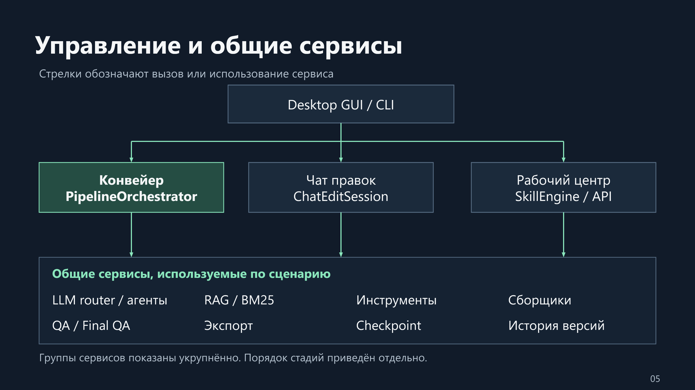

GUI и CLI направляют операции подходящему управляющему компоненту. **PipelineOrchestrator** управляет конвейером, **ChatEditSession** ведёт доработку в чате, **Workbench API / SkillEngine** выполняют операции рабочего центра. Они используют общую инфраструктуру по сценарию. Стрелки обозначают вызов или использование сервиса; карта не задаёт порядок стадий.

Данные задачи связывают запрос, жанр, дизайн, план, результаты и метрики. На границах стадий система получает проверяемый итог и решает, допустимо ли продолжение. Общие сервисы помогают сохранять смысл обязательных проверок при разных способах запуска.

### Пути изменения проекта

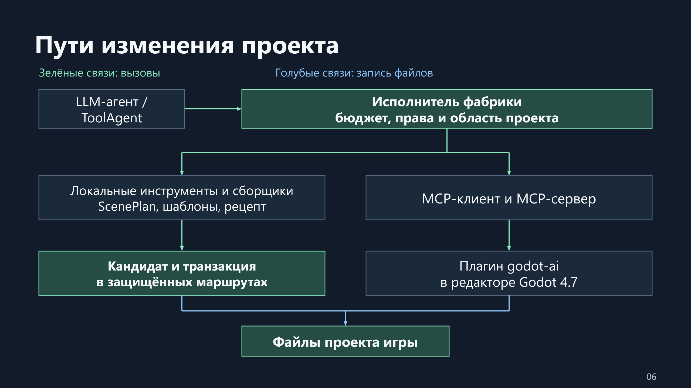

Модель предлагает инструментальное действие. Исполнитель фабрики проверяет бюджет, права и область проекта, затем вызывает разрешённый обработчик. Зелёные связи показывают вызовы, голубые — запись файлов.

Локальные сборщики работают с шаблонами, рецептом и композицией сцен. MCP-клиент и сервер передают редакторные операции плагину godot-ai внутри Godot. Привязка к пути проекта и сессии редактора защищает от выбора чужой цели. Кандидаты и транзакции используются в предусмотренных маршрутах; универсальное одинаковое покрытие всех записей не заявляется.

### Проверка и выпуск

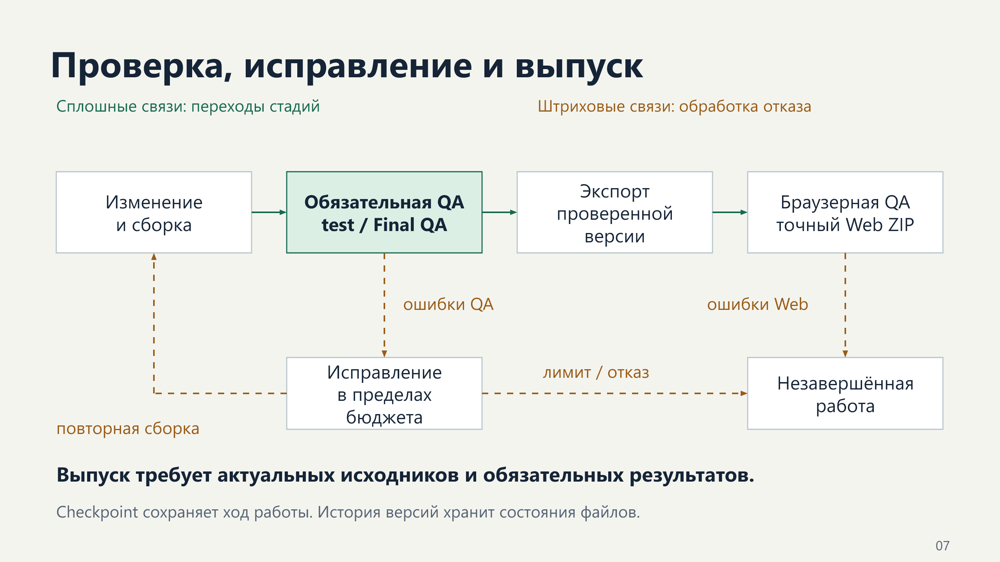

На поддерживаемом Web-маршруте обязательные результаты текущей версии разрешают экспорт, затем браузер проверяет точный Web ZIP. Штриховые связи показывают обработку отказов. Ошибка QA может вернуть работу на исправление в пределах бюджета. Отрицательная браузерная проверка сохраняет незавершённый результат.

Checkpoint хранит состояние выполнения, история версий — состояния файлов, отчёты — доказательства проверок. Восстановление файлов не превращает исторический отчёт в свежую QA. [Архитектура, границы доверия и контракты](docs/ARCHITECTURE.md).

## Конвейер и маршруты генерации

Конвейер содержит 15 канонических стадий. План конкретной задачи зависит от режима, настроек и жанра: некоторые этапы отключаются или не требуются. Общий порядок позволяет связывать результаты с зависимостями и определять точку продолжения.

| № | Стадия | Основная задача |
| --- | --- | --- |
| 1 | analyze | Разобрать запрос и признаки игры |
| 2 | design | Описать дизайн и обязательные механики |
| 3 | master_plan | Подготовить общий план, когда он включён |
| 4 | scaffold | Создать основу проекта и сборочные входы |
| 5 | plan | Составить план реализации |
| 6 | code_gen | Выполнить генерацию или композицию сцен |
| 7 | feel | Настроить игровые реакции и управление |
| 8 | vector_art | Подготовить графическое представление |
| 9 | wire_scenes | Связать сцены, когда это требуется |
| 10 | goal_cycles | Выполнить дополнительные целевые итерации |
| 11 | test | Провести обязательные проверки маршрута |
| 12 | fix_loop | Ограниченно исправить найденные ошибки |
| 13 | verify | Выполнить финальную проверку |
| 14 | export | Экспортировать подтверждённый результат |
| 15 | web_verify | Проверить конкретный Web-артефакт |

| Маршрут | Работа модели и фабрики | Область применения |
| --- | --- | --- |
| Scene-first | Модель описывает композицию, сборщик проверяет и создаёт сцены | Новые кликеры поддерживаемого профиля |
| Lite | Шаблон, компактный контекст и ограниченные правки | Задачи соответствующего профиля и бюджета |
| Полный | Несколько шагов генерации и связывания проекта | Более подробный маршрут реализации |

Scene-first выбирается до lite. Рецепт существующего проекта определяет совместимый путь: открытие старой игры не запускает автоматическую миграцию. В классическом маршруте допустимый мягкий отказ может привести к продолжению на упрощённой основе. Обязательные проверки сохраняют значение. Некорректная сценовая композиция остаётся отказом.

Статус стадии описывает фактический результат. Положительный комментарий модели или высокий суммарный балл не снимает обязательную ошибку. При остановке сохраняются выполненная работа и следующий незавершённый этап.

## LLM, инструменты и контекст

### Инструментальный цикл и бюджеты

Профиль задаёт подключение и ограничения модели. Роль связывает его с анализом, планированием, генерацией или проверкой. Router выбирает разрешённый профиль, а агент с инструментами ведёт последовательность раундов: запрос, ответ модели, допустимое действие, результат и следующий запрос.

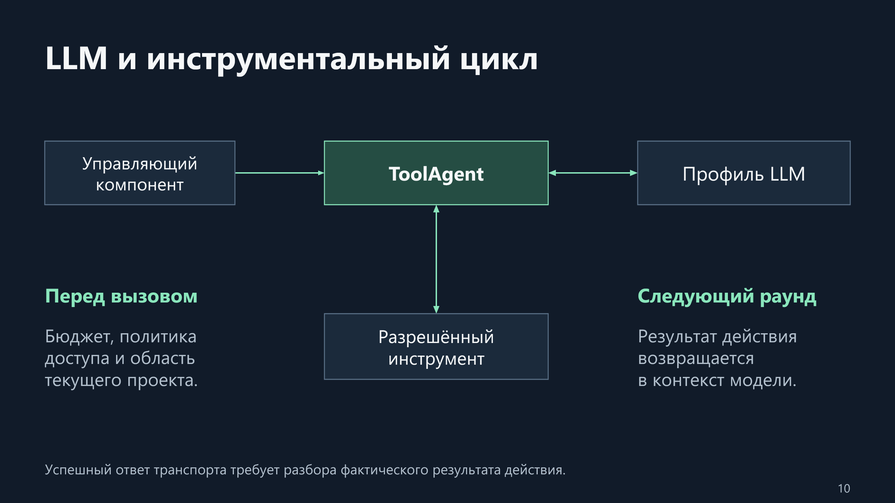

Каталог инструментов и политика записи зависят от стадии и проекта. Маршрутизация сама по себе не расширяет доступ. Успешная доставка ответа инструмента требует дополнительного разбора: само действие могло завершиться отрицательно.

Управление бюджетом ограничивает запросы модели, инструментальные действия, диагностику и время. Ресурс резервируется до вызова. Неудачная фактическая попытка тоже расходует лимит. Агент завершает работу при исчерпании бюджета, отсутствии прогресса или инфраструктурной проблеме и сохраняет объяснимый итог.

Обработка различает сетевой сбой, ограничение частоты, переполнение контекста, ошибку формата и недоступность модели. Реакция зависит от причины и разрешённой политики. Явно закреплённый профиль не должен скрытно заменяться другим. [Маршрутизация и обработка отказов](docs/LLM_AND_CONTEXT.md).

### BM25 и навыки

База знаний содержит документацию, примеры, жанровые материалы и карточки навыков. BM25 — лексический метод поиска: он ранжирует материалы по совпадению терминов. Фильтры версии, жанра и типа источника отбирают совместимый контекст.

Фабрика отдельно учитывает слова задачи и жанровое расширение, добавляет сигналы имени компонента и типа материала. Затем удаляет повторы источников и упаковывает выдержки в бюджет. Такая организация сохраняет конкретную механику запроса рядом с общими жанровыми сведениями.

Карточка навыка описывает подход и условия применения. Исполняемое действие имеет зарегистрированный обработчик, параметры и проверку результата. В срезе **22 октября** зафиксированы **412 карточек и 40 действий**. Для 300 новых карточек предусмотрены контракты. Размер каталога характеризует справочный слой, а протокольные тесты действий местами используют фикстуры внешних подсистем.

Повторное использование успешного решения требует происхождения и актуального доказательства. Отзыв результата должен отражаться и в поиске, включая кэш. [Алгоритмы поиска](docs/ALGORITHMS.md) · [Навыки и рабочий центр](docs/WORKBENCH.md).

## Согласованность проекта

### План, рецепт и состав сборки

ScenePlan описывает сцены, параметры и связи. GameRecipe закрепляет версии шаблонов, компонентов и сборочные параметры. Manifest хранит сведения об установленной основе и файлах. Совместно они позволяют обнаружить расхождение с ожидаемым составом и выполнить явное обновление.

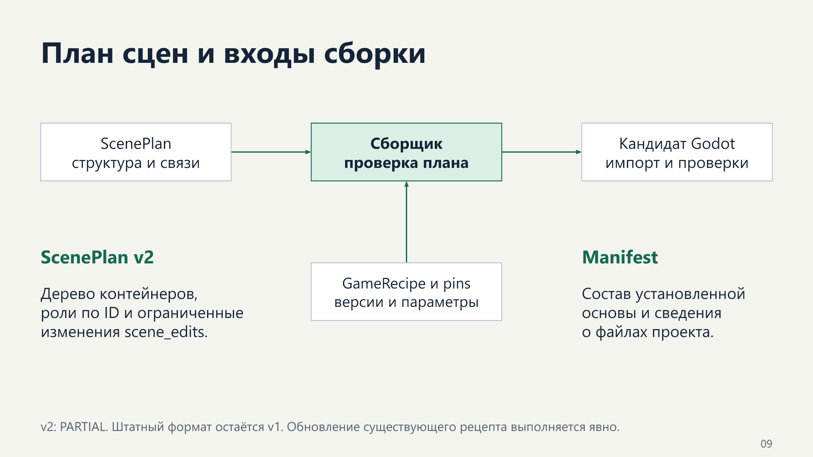

Валидация охватывает схему, доступные компоненты, идентификаторы, обязательные связи и совместимость интерфейсов. Новая механика может потребовать отдельного проектного расширения и его тестов. Корректная схема ещё требует проверки поведения в движке.

ScenePlan v2 добавляет дерево контейнеров, роли по ID и ограниченные `scene_edits`. Невалидный структурный ответ получает одну попытку исправления с диагностикой. Повторный отказ сохраняет рабочую сборку и незавершённую стадию. **Общий статус v2 — PARTIAL; штатный формат остаётся v1.**

### Кандидаты и транзакции

В защищённых маршрутах предлагаемая версия существует отдельно от рабочей игры. Проверки исследуют кандидата, затем фабрика повторно сверяет хеши базовых файлов. Изменившаяся база означает конфликт: проверенную правку нельзя переносить поверх нового состояния без разрешения расхождения.

Журналируемая транзакция согласует файлы и метаданные. При отказе сохраняются предусмотренные материалы диагностики и восстановления. Этот механизм требует времени, импорта и места на диске. Его область — поддерживаемые маршруты изменений, без обещания универсальной песочницы.

### Продолжение, версии и сохранения

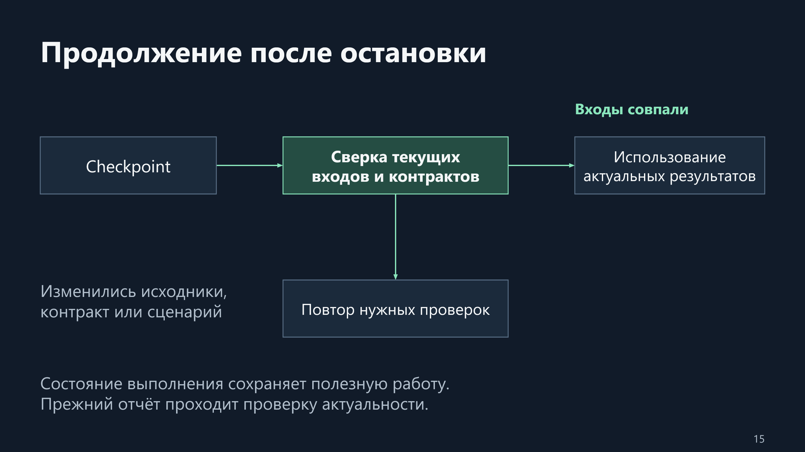

Checkpoint хранит завершённые стадии и данные продолжения. Перед использованием старого результата фабрика проверяет его связь с текущими исходниками, контрактом и сценарием. Изменённые входы требуют повторной проверки соответствующих результатов.

Отдельная Git-история хранит состояния игры. Revert создаёт обратное изменение с учётом независимых поздних правок, restore восстанавливает снимок отдельной операцией. Пользовательское Git-хранилище не используется как внутренняя история фабрики.

Прогресс игрока сохраняет базовый runtime с двумя чередующимися JSON-слотами. Неудачная запись оставляет предыдущее корректное поколение. Загрузка учитывает целостность и миграции, неизвестная новая схема не перезаписывается пустым состоянием. Для Web сохранения зависят от браузерного хранилища. [Алгоритмы состояния и восстановления](docs/ALGORITHMS.md).

## Качество и игровые кейсы

| Уровень | Что проверяет |
| --- | --- |
| Статика и контракты | Файлы, ресурсы, схемы и обязательные связи |
| Нативный Godot | Импорт, запуск и диагностируемые runtime-ошибки |
| Игровые пробы | Наблюдаемые правила конкретной механики |
| Final QA | Совокупность обязательных результатов для игры |
| Web-сценарий | Поведение точного экспортированного архива |
| Внешняя приёмка | Реальное SDK-окружение и условия площадки |

Проверка прыжка платформера использует непрерывную историю физических кадров. Проверка сохранений сравнивает состояние после повторного запуска или reload. Такая конкретизация важна: два снимка положения ещё не описывают прыжок, а видимая подпись усилителя ещё не подтверждает его эффект.

Отпечатки SHA-256 связывают отчёт с исходниками, сценарием и архивом. Изменение значимых входов требует нового подтверждения. Хеш устанавливает соответствие файлов, а полнота сценария остаётся отдельным свойством проверки. [Качество и выпуск](docs/QUALITY_AND_RELEASE.md).

### «Мастерская»: проверка правил и восстановление

В принятом A10 временный усилитель удваивает только клики на пять секунд. Доступны три сохраняемых заряда; повторное нажатие во время действия не расходует ещё один. Цель — накопленный результат 100. Пассивный доход проверяется отдельно от усиления ручного действия.

92-шаговый сценарий включает покупки, доход, усиление, достижение цели, reload, сброс и повторную победу в трёх размерах экрана. В истории исправлялись связь таймера, обновление накопленного результата и заголовка, затем обрезание интерфейса в горизонтальной ориентации.

Один операторский ответ не поступил вовремя. Уже зафиксированный проект сохранился, следующий resume продолжил работу. Вся цепочка A10 содержит исходный запуск и пять продолжений: **86 запросов, 701 действие инструмента, 97 мин 28 с**. Финальное продолжение отдельно заняло **10 мин 44 с**. Это расходы конкретной assisted-серии.

### Другие принятые случаи

«Три ключа» проверяет по три ключа на каждом уровне, отказ преждевременного выхода, смерть, переходы и полный restart. Полное прохождение подтверждено на desktop; мобильный результат имеет меньший объём.

«Две мастерские» предлагает специализацию за 10 единиц: ручную силу 3 или автоматический доход 1 в секунду. Вторая ветка после выбора недоступна. Проверены обе ветки, цель 50, сохранение и сброс. [Сценарии и расходы серии](docs/CASE_STUDIES.md).

## Инженерные решения и зрелость

| Решение | Зачем принято | Компромисс |
| --- | --- | --- |
| Стадии и сохранённое состояние | Продолжать длительную задачу после отказа | Согласование зависимостей и устаревших результатов |
| Шаблоны и композиция | Уменьшить число произвольных решений модели | Границы каталога и отдельная работа над расширениями |
| Лексический поиск | Объяснять подбор без отдельной векторной инфраструктуры | Зависимость от корпуса и формулировок |
| Проверяемые кандидаты | Исследовать правку до принятия | Дополнительные импорт, время и место |
| Привязка доказательств | Обнаруживать устаревший положительный отчёт | Повторная QA после изменений |
| Ограниченный ремонт | Контролировать расходы длительной задачи | Возможность частичного результата |

Рабочий центр объединяет проекты, планы действий, предложения, версии и диагностику. Четыре набора организованы вокруг мобильного платформера, сохранений, оптимизации слабого телефона и подготовки выпуска. Название набора описывает цель работы; положительное улучшение конкретной игры требует измерения.

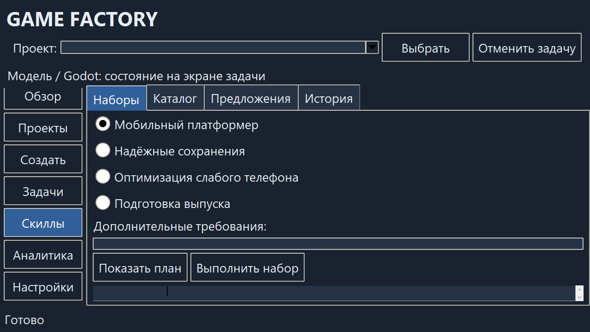

SQLite-аналитика хранит события и показатели локально. Сбой графика не должен менять QA, а отсутствующее измерение не выдаётся за нулевое. В измерении повторных сводок использована синтетическая история из 10 020 событий и 20 запусков. Первая сводка изменилась с 107,02 до 94,90 мс: основной выигрыш относится к повторному чтению.

Открыты полная приёмка ScenePlan v2, матрица действий с реальными подсистемами и надёжность на новых запросах. Физические телефоны, публикация и коммерческие показатели требуют отдельного подтверждения. Изменять движок для проблем описанной серии не потребовалось: работа сосредоточена на оркестрации, адаптерах и проверках вокруг Godot.

Проект демонстрирует управление состоянием Python-приложения с внешней LLM и игровым движком. Центральная инженерная задача — согласовать файлы, редактор, состояние выполнения и доказательства так, чтобы итог относился к одной версии игры. [Обоснования решений](docs/ENGINEERING_DECISIONS.md).

## Подробная документация

| Документ | Что раскрывает |
| --- | --- |
| [Архитектура](docs/ARCHITECTURE.md) | Подсистемы, данные, процессы и границы доверия |
| [Алгоритмы](docs/ALGORITHMS.md) | Поиск, композиция, транзакции, ремонт и сохранения |
| [LLM и контекст](docs/LLM_AND_CONTEXT.md) | Профили, инструментальный цикл, ошибки и бюджеты |
| [Качество и выпуск](docs/QUALITY_AND_RELEASE.md) | Игровые пробы, Final QA, Web и актуальность доказательств |
| [Рабочий центр](docs/WORKBENCH.md) | Навыки, наборы, версии, аналитика и обучение |
| [Игровые примеры](docs/CASE_STUDIES.md) | Требования, исправления, результаты и расходы |
| [Инженерные решения](docs/ENGINEERING_DECISIONS.md) | Причины выбора механизмов и их цена |
| [Проверки и методика](docs/VALIDATION.md) | Происхождение результатов и область подтверждения |

## Формат публикации

Комплект предназначен для знакомства с проектом и обсуждения инженерных решений. Он не содержит дистрибутив, установочные файлы, исходники или игровые сборки. Сторонние технологии принадлежат их правообладателям.
