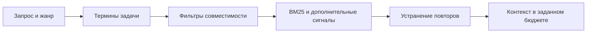
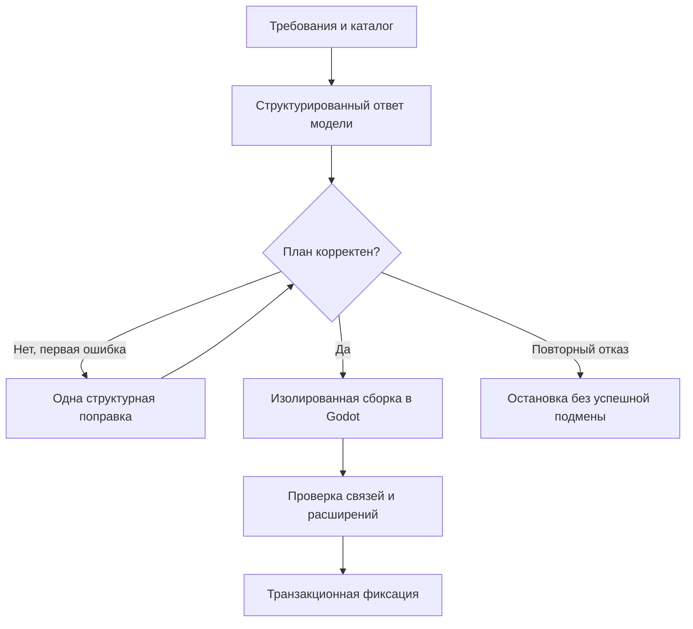
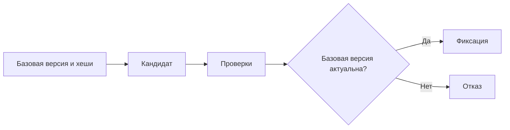
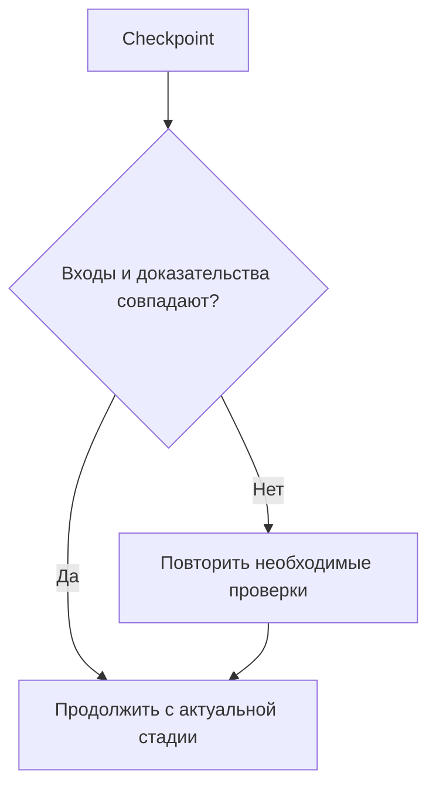
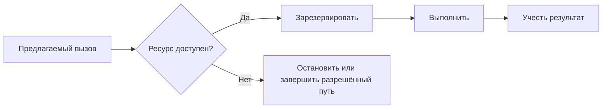

# Алгоритмы и инженерные решения

[Обзор проекта](../README.md) · [Презентация PDF](../presentation/Game-Factory-v4.pdf) · [Архитектура](ARCHITECTURE.md) · [Проверки и методика](VALIDATION.md)

Описания передают принципы работы без публикации реализации. Это обзор существующих механизмов, а не инструкция для установки приложения.

## 1. Поиск контекста через BM25

**Задача:** выбрать материалы, которые помогают решить текущую задачу модели и помещаются в доступный контекст.

1. Фабрика индексирует документацию, примеры, алгоритмы и карточки навыков с метаданными.
2. Поиск отдельно учитывает термины исходной задачи и расширение по жанру. Двуязычные ключевые слова помогают русскому запросу находить англоязычные материалы.
3. Фильтры исключают несовместимые версии, неподходящие жанры и типы источников.
4. Ранжирование учитывает BM25, совпадение имени компонента и веса типов источников. Прямое совпадение с задачей имеет приоритет перед общим жанровым совпадением.
5. Фабрика исключает повторные источники и ограничивает концентрацию материалов одного объекта там, где это предусмотрено поиском.
6. Упаковщик контекста добавляет выбранные выдержки и обязательные материалы, сохраняя бюджет.

**Компромисс:** лексический поиск прост в сопровождении и позволяет объяснить найденные совпадения, но зависит от словаря и качества корпуса. Расширение запроса и структурные метаданные уменьшают эту зависимость. Наличие RAG само по себе не доказывает повышение качества на любом запросе.

## 2. Сборка ScenePlan

**Задача:** согласовать ответ модели с существующей библиотекой сцен и контрактами проекта.

1. До компоновки фиксируются требования и критерии приёмки запроса.
2. Модель получает каталог компонентов, интерфейсы и ограничения.
3. Ответ задаёт план сцены или ограниченные изменения существующего плана.
4. Валидатор проверяет структуру, ID, роли, параметры и обязательные связи.
5. Некорректный структурный ответ получает одну ограниченную попытку исправления с точной диагностикой.
6. Сборщик создаёт кандидата, импортирует его в Godot и проверяет связи и проектные расширения.
7. Успешный кандидат может пройти фиксацию. Повторный отказ сохраняет незавершённое состояние.

**Компромисс:** библиотека задаёт пределы композиции. Новая механика может потребовать отдельного компонента и дополнительных проверок. Принятый структурный план ещё не доказывает интересный игровой процесс.

## 3. Изолированный кандидат и транзакция

**Задача:** проверить изменение до его принятия и обнаружить параллельное изменение исходной версии.

1. Фабрика фиксирует базовое состояние и отпечатки файлов.
2. Создаёт отдельного кандидата с предлагаемыми правками.
3. Выполняет предусмотренные проверки кандидата, включая Godot для соответствующего маршрута.
4. Перед фиксацией повторно сверяет исходное состояние.
5. Если входы не изменились и проверки пройдены, фиксирует согласованные файлы и метаданные.
6. При отказе использует журнал транзакции и восстановление прежнего состояния.

Защита реализована в отдельных маршрутах, включая сценовую композицию и поддерживаемые локальные правки. Она не заявляется одинаковой для всех возможных мутаций через MCP.

## 4. Ограниченный цикл исправлений

**Задача:** исправлять диагностируемые ошибки без бесконечного повторения одинаковых действий.

Фабрика собирает ошибки в диагностический пакет и формирует ограниченный контекст для следующего шага модели. Перед запросами и вызовами инструментов учитывается доступный бюджет. Повторяющаяся диагностика и отсутствие прогресса могут завершить цикл раньше предельного количества попыток.

После успешного ремонта обязательная проверка повторяется, если прежний результат был отрицательным или относился к другим исходникам. Старый результат не становится успешным только потому, что модель сообщила об исправлении.

**Компромисс:** ограничение защищает время и ресурсы, но часть задач остаётся незавершённой. Checkpoint позволяет разбирать такой результат и продолжать его осознанно.

## 5. Возобновление и актуальность доказательств

**Задача:** продолжить работу после сбоя, сохранив связь между результатом проверки и проверенными входами.

Фабрика сохраняет порядок выполненных стадий, результаты и версию контрольной точки. При возобновлении она сверяет исходники и связанные критерии. Для Web-проверок учитываются также сценарий и конкретный экспортированный архив.

Хеш подтверждает соответствие файлов сохранённому доказательству. Он не доказывает полноту сценария и качество самой проверки.

## 6. Проверка игрового поведения

Для поддерживаемых жанров фабрика использует наблюдаемое поведение: ввод, состояние игры, сохранение и восстановление прогресса. Например, нативная проба прыжка платформера анализирует непрерывную историю физических кадров одного игрока и сцены, а также подтверждает доставку и отпускание ввода.

Браузерные сценарии выполняют реальный ввод и читают предусмотренные наблюдения. Проверка сохранений сопоставляет состояние до и после перезагрузки. Внутренний тест API, техническая фикстура и игровой сценарий имеют разные границы доказательства.

**Компромисс:** сценарий должен соответствовать конкретной механике. Поддержка проверок кликера не переносится автоматически на любую другую игру.

## 7. Сохранения с чередующимися слотами

Базовый игровой runtime хранит прогресс в двух чередующихся JSON-слотах. При неудачной записи прежнее корректное поколение остаётся доступным. Миграция учитывает прежний формат, а повреждённые или неизвестные новые схемы сохраняются без перезаписи пустым состоянием.

Для кликера события покупок и кликов сохраняются сразу, а пассивные начисления объединяются с ограничением частоты записи. В Web сохранность зависит от хранилища браузера. Этот механизм не обеспечивает синхронизацию между устройствами.

## 8. Приоритеты ранжирования RAG

Упрощённо поиск решает две разные задачи: найти материал о требуемой механике и поддержать его жанровым контекстом. Если объединить все слова без различия, общие материалы жанра могут вытеснить конкретный нужный компонент.

Реализация учитывает сигналы в следующем смысле:

1. Есть ли совпадение со словами исходной задачи.
2. Есть ли точное совпадение с именем алгоритмического компонента.
3. Каков итоговый лексический балл с дополнительными весами.

Внутри балла основной BM25 дополняется ограниченным вкладом жанровых терминов, сигналом имени источника и весом типа материала. Слабое жанровое совпадение не должно автоматически стать сильнее прямого совпадения с задачей.

**Иллюстрация принципа:** запрос о сохранении выбора специализации содержит конкретное требование. Документ о сохранениях и соответствующий компонент полезнее общего списка механик кликера. Это пример логики выбора, а не опубликованный результат нового поискового прогона.

После отбора действует устранение повторов по источнику. Для соответствующих поисков ограничивается концентрация результатов одного объекта, например asset-пакета.

При N фрагментах полный проход по оценкам и фильтрам зависит от размера корпуса. Сортировка кандидатов в обычной реализации даёт компонент порядка N log N. Это оценка структуры алгоритма, а не измеренная скорость приложения.

## 9. Публикация нового индекса

**Проблема:** фоновая переиндексация не должна оставлять читающую задачу с половиной старого и половиной нового корпуса.

Новый индекс строится отдельно. Пока сборка не завершена, читатели используют прежнее целое состояние. После успешного построения опубликованное состояние заменяется согласованно. Ошибка построения не уничтожает пригодный предыдущий индекс.

Отпечаток индекса учитывает значимые входы и параметры. Повреждённый кэш можно перестроить. Сам факт наличия кэш-файла не делает его актуальным.

**Компромисс:** во время перестроения требуется память для отдельного состояния. Читатели могут временно использовать прежний корпус, но избегают частично собранного индекса.

## 10. Проверка допуска навыка

У поиска и допуска разные задачи. Поиск отвечает за релевантность, допуск — за совместимость с текущей операцией.

Для карточки учитываются метаданные, этап, жанр, версии и инструменты. Явно описанные инструментальные примеры проходят предусмотренные проверки схемы. Неизвестная схема не получает статус проверенной только потому, что JSON удалось разобрать.

Receipt сохраняет состав допущенного контекста и причины исключений в предусмотренном объёме. Он нужен для воспроизводимого разбора подсказки. Доставка карточки ещё не подтверждает исполнение действия или переносимость паттерна.

## 11. Контракт приёмки до генерации

**Проблема:** если ожидания пересчитать после ремонта из уже изменённой экономики, неправильный результат может начать подтверждать сам себя.

В поддерживаемом сценовом маршруте критерии фиксируются до компоновки. Числовые условия и игровые требования остаются самостоятельным входом проверки. Модель получает их и при исправлении.

Новая просьба пользователя создаёт согласованную ревизию. Явно заменённые условия обновляются, остальные сохраняются. Отказ генерации не помечает ожидающую ревизию выполненной.

Пример: изменение расположения магазина не должно менять цену улучшения. Если новая просьба действительно меняет цену, это отдельное изменение требования, которое должно попасть в актуальную ревизию.

## 12. Рецепт и детерминированная сборка

Рецепт фиксирует выбранные входы: основу проекта, алгоритмы, компоненты и параметры поддерживаемой сборки. Отпечатки позволяют обнаружить дрейф этих входов.

Некоторые ресурсы создаются без LLM: например, поддерживаемые данные уровня по seed, синтезированные звуки и ресурсы частиц. Для соответствующих сборочных входов можно пересоздать результат во временном месте и сравнить байты.

Совпадение байтов подтверждает воспроизводимость этой части сборки. Оно не делает ответ модели детерминированным и не доказывает полное игровое поведение.

Явное обновление рецепта сначала проверяет установленную основу, затем меняет закреплённые входы через предусмотренную операцию. Открытие проекта не должно само мигрировать его на новую библиотеку.

## 13. Резервирование бюджета

Если учитывать попытку только после успешного ответа, тайм-ауты и параллельные обращения могут нарушить предел. Резервирование до вызова учитывает фактическую попытку независимо от её полезности.

Ограничения разных измерений независимы: свободные запросы модели не означают свободное время или доступную диагностику. Итог фиксирует фактическую причину остановки.

## 14. Привязка отчёта к источникам

Концептуально доказательство описывает набор входов: проверяемые файлы, сценарий, проверяющий механизм и соответствующий артефакт. Точный состав зависит от проверки.

При повторном использовании фабрика сравнивает необходимые отпечатки. Несовпадение не означает, что новая версия плохая. Оно означает, что прежний отчёт её больше не подтверждает.

Это различие позволяет сохранить полезные результаты предыдущих стадий, повторив нужную QA. При этом старые доказательства доступны как история и не переписываются задним числом в свежий PASS.

## 15. Откат отдельного изменения

Откат и полное восстановление решают разные задачи. Откат должен добавить обратное изменение, сохранив независимые более поздние правки, где это возможно. Восстановление снимка целиком является отдельной операцией.

Кандидат объединения проверяется до переноса. Конфликт показывает затронутые пути и сохраняет рабочую игру. Журнал согласует перенос файлов и обновление ссылки истории, а восстановление после сбоя учитывает уже выполненные шаги.

Исторический QA не становится свежим после возврата исходников. Отдельная эпоха проверки позволяет сохранить это различие даже при восстановлении прежних файлов.

## 16. Алгоритм A/B-сохранений подробнее

Чередование слотов уменьшает риск потерять последнее корректное поколение при неудачной новой записи. Загрузка должна учитывать корректность данных, поддерживаемую схему и пригодное поколение, а не просто выбирать файл по имени.

| Ситуация | Требуемый смысл поведения |
| --- | --- |
| Новая запись успешна | Новое поколение доступно для восстановления |
| Новая запись повреждена | Предыдущее корректное поколение сохраняет значение |
| Найден старый поддерживаемый формат | Выполняется предусмотренная миграция |
| Найдена неизвестная новая схема | Данные сохраняются без перезаписи пустым состоянием |
| Пассивный доход меняется часто | Записи могут объединяться с ограничением частоты |

Это механизм локального прогресса. Браузерное хранилище, очистка данных пользователем и переход на другое устройство остаются отдельными условиями.

## 17. Наблюдение поведения вместо двух снимков

Для прыжка платформера проверяется последовательность состояний: подтверждённая опора, реальное нажатие, непрерывное движение вверх и отпускание. Данные должны относиться к тому же игроку и сцене.

Смена сцены, разрыв наблюдения или неподтверждённая доставка ввода не подменяются правдоподобной конечной позицией. Таким образом проверка делает вывод по измеренному поведению, а не по текстовому обещанию модели.

Проверка остаётся ограниченной: корректный прыжок не доказывает проходимость уровня и качество всей игры.

## 18. Кэш сводок и поток событий

Аналитика повторно использует вычисленную сводку, пока соответствующая ревизия хранилища и область проекта остаются актуальными. Новые события из другого процесса должны отзывать устаревший результат.

Хвост событий читается ограниченными порциями. Повторная доставка не создаёт дублирующие точки. При смене проекта прежний ответ не переиспользуется для новой области.

Частота перерисовки связана с видимостью графика. Сбор данных и отрисовка не обязаны происходить с одной частотой. Это уменьшает лишнюю работу интерфейса, сохраняя поступление событий.

Локальные измерения этих механизмов приведены в [VALIDATION.md](VALIDATION.md). Они относятся к аналитике и поиску, не к скорости генерации или FPS игры.
