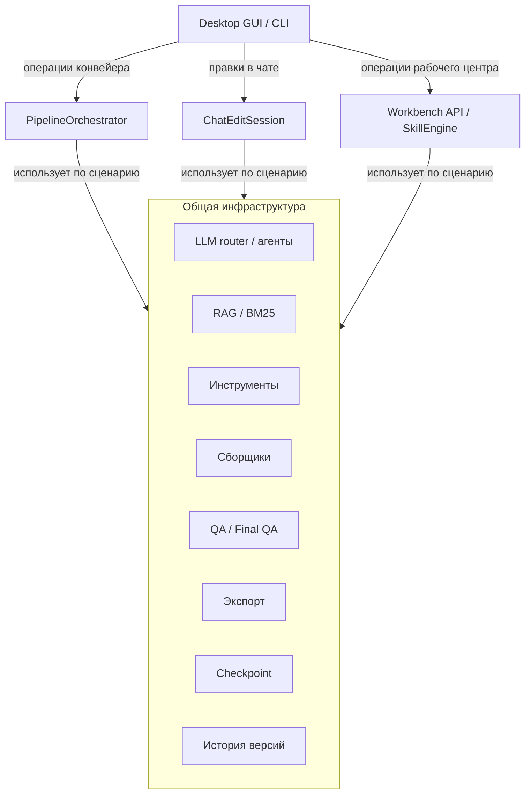
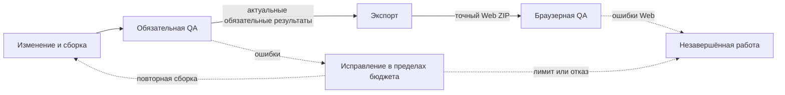
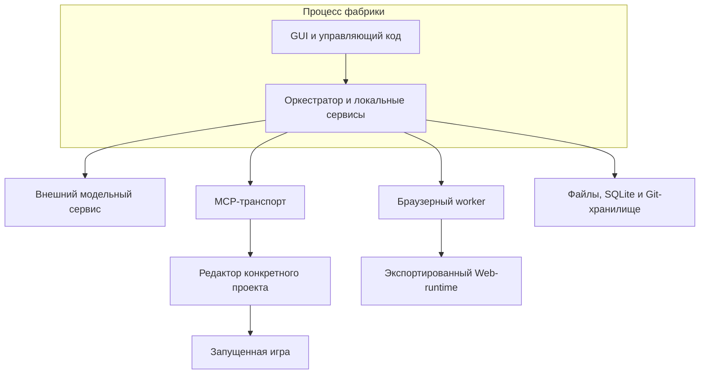

# Архитектура Game Factory

[Обзор проекта](../README.md) · [Презентация PDF](../presentation/Game-Factory-v4.pdf) · [Архитектура](ARCHITECTURE.md) · [Проверки и методика](VALIDATION.md)

Документ описывает устройство закрытого проекта на уровне подсистем и контрактов. Схемы упрощают внутреннюю реализацию. Исходный код в этом репозитории отсутствует.

## Основные подсистемы

Все стрелки этой карты означают вызов или использование. Общая инфраструктура является логической группой модулей, а не одним классом. Состав фактических вызовов зависит от операции. Чат не показан как стадия конвейера, а checkpoint отделён от истории файлов.

Редактируемая карта компонентов в Mermaid

| Подсистема | Ответственность |
| --- | --- |
| Интерфейс | Запрос, выбор проекта, планы действий, диагностика, история |
| Оркестратор | Порядок стадий, отмена, бюджеты, обработка отказов, продолжение |
| LLM | Профили моделей, контекст, структурированные ответы, вызовы инструментов |
| База знаний | Индексация и подбор совместимых источников для текущей задачи |
| MCP | Связь с конкретным проектом и редактором Godot |
| Сборщик | Шаблоны, ресурсы, рецепт, композиция сцен, детерминированные операции |
| QA | Проверка файлов, запуска и наблюдаемого игрового поведения |
| Состояние | Контрольные точки, актуальность доказательств, история версий |
| Экспорт | Формирование Web-архива и проверка именно этого артефакта |
| Аналитика | Локальная SQLite-история и показатели работы |

GUI и CLI используют общие сервисы. Чат правок работает поверх той же инфраструктуры LLM/MCP, сохраняя особенности пользовательского редактирования.

## Жизненный цикл задачи

Эта схема описывает порядок работы поддерживаемого Web-маршрута. Сплошные связи являются переходами стадий, штриховые показывают обработку отказа. Она не является графом зависимостей модулей.

Редактируемый цикл в Mermaid

Полный порядок стадий в реализации:

| № | Стадия | Назначение |
| --- | --- | --- |
| 1 | analyze | Разбор запроса и жанра |
| 2 | design | Структурированное описание игры |
| 3 | master_plan | Общий план при включённом маршруте |
| 4 | scaffold | Подготовка проекта из шаблона |
| 5 | plan | План реализации при включённом маршруте |
| 6 | code_gen | Генерация или композиция сцен |
| 7 | feel | Игровые реакции и параметры ощущения игры |
| 8 | vector_art | Подготовка графического представления |
| 9 | wire_scenes | Связывание сцен, когда его требует маршрут |
| 10 | goal_cycles | Дополнительные целевые итерации |
| 11 | test | Обязательные тесты выбранного маршрута |
| 12 | fix_loop | Ограниченное исправление найденных ошибок |
| 13 | verify | Финальная проверка |
| 14 | export | Экспорт результата |
| 15 | web_verify | Проверка Web-артефакта в браузере |

Наличие стадии в порядке не означает её выполнение в каждом запуске. Scene-first, lite и полный маршрут используют разные способы генерации. Конфигурация управляет опциональными стадиями и требованиями к выпуску.

## Разделение модели и сборщика

Модель предлагает структуру и изменения в рамках разрешённого интерфейса. Сборщик проверяет схему, доступность компонентов, связи и совместимость. Детерминированные операции создают воспроизводимые части результата из фиксированных входов.

В новых кликерах ScenePlan описывает композицию готовых компонентов. GameRecipe фиксирует версионированные входы сборки и связанные параметры. У v2 есть дерево контейнеров и роли по ID, а обновление рецептов требует явного действия. Старые проекты сохраняют совместимый маршрут.

Детерминированность отдельных ресурсов или сборочных шагов не означает полную воспроизводимость ответов LLM и поведения произвольной игры.

## Хранение состояния

Проект игры хранится отдельно от фабрики. Его служебные данные включают контрольную точку, рецепт, требования, метрики, отчёты QA и метаданные экспорта. Эти файлы не входят в публичный репозиторий портфолио.

Контрольная точка хранит выполненные стадии и результаты. При продолжении фабрика проверяет актуальность доказательств по отпечаткам исходников и связанным контрактам. Изменившиеся входы требуют повторной проверки соответствующих стадий.

Рабочий центр использует собственную историю версий генерируемого проекта. Аналитика остаётся локальной, а сбой наблюдения не должен останавливать основную задачу.

## Границы доверия

- Ответ модели проходит структурную и инструментальную проверку.
- Генерация ограничивает доступ к общим служебным файлам и интеграциям.
- MCP привязывается к конкретному проекту и экземпляру редактора.
- Изолированные кандидаты и транзакции защищают поддерживаемые маршруты изменений.
- Обязательный отрицательный результат проверки сохраняет запрет положительного завершения.
- Статус технической проверки не подменяет игровую приёмку или готовность публикации.

Защита зависит от конкретного маршрута. Документ не заявляет универсальную песочницу для любого кода или одинаковое покрытие всех инструментов.

## Пути изменения проекта

Здесь отдельно показаны вызовы и запись файлов. Модель возвращает предложения инструментальных действий. Исполнитель фабрики проверяет применимые ограничения и выбирает поддерживаемый локальный или MCP-маршрут.

Локальные операции включают файловые инструменты и сборщики, использующие ScenePlan, шаблоны и рецепт. В защищённых маршрутах кандидат проходит предусмотренные проверки, затем изменение фиксируется транзакцией.

MCP-клиент обращается к серверу, связанному с плагином godot-ai в редакторе Godot. Цель операции — точно выбранный проект либо его изолированный кандидат согласно маршруту. Схема не утверждает отсутствие транзакционной защиты MCP и не заявляет одинаковое покрытие всех операций.

Вызов Godot для нативной проверки локального кандидата является отдельной зависимостью и на этой схеме записи опущен. Чтение, запуск игры и вся диагностика также не перечислены. Поэтому схему следует читать как объяснение основных путей изменения, а не полный call graph.

## Разделение смыслов

| Схема | Что означает связь | Что она не изображает |
| --- | --- | --- |
| Управление и общие сервисы | Вызов или использование компонента | Порядок выполнения стадий |
| Пути изменения проекта | Вызов либо запись файлов, согласно цвету | Полный набор чтений и проверочных вызовов |
| Проверка и выпуск | Переход стадии либо обработка отказа, согласно типу линии | Публикацию на внешней площадке |

Checkpoint хранит состояние выполнения. История версий хранит состояния файлов. Эти механизмы поддерживают восстановление, но не объединены в одну стадию конвейера.

Схемы пересмотрены 25 октября 2026 года по реализации управляющих сервисов, инструментального исполнения и release-стадий. Новая редакция схем не является новым прогоном игровых проверок.

## Данные и контракты

| Сущность | Что описывает | Кто использует |
| --- | --- | --- |
| JobSpec | Запрос, жанр, режим, циклы и цель проекта | Оркестратор и стадии |
| AnalyzeResult | Название, жанр, признаки и идентификатор результата анализа | Дизайн и подготовка |
| GDD | Сцены, сущности, механики и обязательные требования | Генерация, ремонт и проверки |
| WorkPlan | Предлагаемый порядок реализации и условия выполнения | Генерирующие агенты |
| GameRecipe | Версионированные входы сборки и закреплённые компоненты | Сборщик и операции обновления |
| ScenePlan | Структура, параметры и связи композиции | Сценовый маршрут |
| StageResult | Итог стадии и дополнительные данные | Политика завершения и checkpoint |
| Final QA | Результаты обязательных фаз и технический итог | Финализация и выпуск |
| Release evidence | Связь отчёта с источниками и артефактом | Экспорт, browser QA и gate |

Таблица описывает назначение объектов, а не публикует полный внутренний формат. Изменение одного контракта может требовать обновления нескольких потребителей. Например, новые роли сцены нужны и сборщику, и игровому наблюдателю.

## Границы процессов

Количество процессов зависит от операции. Схема выделяет границы ответственности: модель, редактор, игра и браузер могут отказать независимо.

Тайм-аут связи не всегда означает, что действие не началось. Если исход мутации неизвестен, повтор может применить её дважды. Такие случаи требуют нового подтверждённого состояния или привязки, а не обычного сетевого retry.

## Обязанности на границе стадии

Стадия получает текущую задачу и разрешённые сервисы, выполняет операцию, возвращает результат и сохраняет необходимые артефакты. Оркестратор решает, можно ли двигаться дальше.

Практически важно различать:

- Отрицательный результат самой работы.
- Мягкую вспомогательную ошибку, при которой маршрут допускает продолжение.
- Отмену пользователя.
- Фактическую остановку по бюджету.
- Отсутствующее подтверждение обязательной проверки.

Эти состояния нельзя свести к одному исключению «что-то не получилось». Например, ошибка необязательного поиска контекста может оставить базовый prompt пригодным. Отказ запуска обязательного редактора такого послабления не даёт.

## Согласованность диска и редактора

Godot хранит загруженные ресурсы и состояние открытых сцен. Изменение файла Python-стадией ещё не означает, что редактор использует новую версию.

Перед игровыми проверками предусмотрен барьер синхронизации ресурсов. Он подтверждает привязку проекта, выполняет нужный discovery/import и проверяет результат. Неизвестный исход операции блокирует бесконтрольный повтор.

При работе с живым редактором guard также проверяет пригодность переноса изменений. Несохранённая сцена или неподтверждённый адаптер могут остановить действие. Совпадение файлов addon на диске не доказывает, что именно эту версию загрузил редактор.

## Служебные данные игры

| Группа | Примеры артефактов | Назначение |
| --- | --- | --- |
| Входы | Запрос, GDD, план, критерии | Смысл задачи и ожидаемое поведение |
| Сборка | Рецепт и manifest | Используемые компоненты и установленные файлы |
| Продолжение | Checkpoint и состояние циклов | Следующая незавершённая работа |
| Проверки | Диагностика, игровые и браузерные отчёты | Наблюдаемые результаты |
| Выпуск | Архив и связанные метаданные | Точный передаваемый артефакт |
| Наблюдаемость | Метрики и события | Разбор выполнения |

Публичный комплект содержит только объяснение этих данных. Сами служебные файлы, пользовательские запросы и конфигурации в него не включены.

## Три вида восстановления

**Продолжение задачи** использует checkpoint и актуальные результаты стадий. **Восстановление проекта** переносит выбранную версию файлов через контролируемую операцию. **Восстановление прогресса игрока** читает игровые слоты сохранения.

Эти механизмы не подменяют друг друга. Продолжение не должно молча откатывать изменения пользователя. Git-снимок не хранит текущую игровую сессию. Успешное чтение прогресса не подтверждает корректность всех исходников игры.

## Расширение системы

Новый жанр требует согласованных шаблона, жанровых материалов, правил генерации и сценариев проверки. Один новый пункт каталога не создаёт сквозную поддержку.

Новый компонент ScenePlan требует описания интерфейса, правил допустимых связей и проверки исполнения. Новое действие навыка требует обработчика, параметров, ограничений и понятной области результата.

Новый профиль модели требует проверки совместимости формата и инструментов. Техническая доступность endpoint ещё не доказывает пригодность его ответов для игрового маршрута.

## Ключевые инварианты

| Инвариант | Какой класс ошибки предотвращает |
| --- | --- |
| Операция относится к конкретному пути и сессии | Редактирование или проверку чужого проекта |
| Кандидат сверяется с базой перед применением | Потерю внешних правок |
| Обязательный отказ сохраняется в итоговой политике | Ложный успех по частичному отчёту |
| Отчёт связан с входами | Перенос старого PASS на новую сборку |
| Требования сохраняются при короткой чат-правке | Исчезновение прежних игровых правил |
| Неопределённая мутация не повторяется как безопасная | Дублирование действий |
| Память проверяет пригодность при выдаче | Использование отозванного успешного примера |

Детальные маршруты и исключения остаются частью закрытой реализации. Таблица описывает архитектурный смысл защиты, а не универсальную гарантию для любого произвольного действия.
