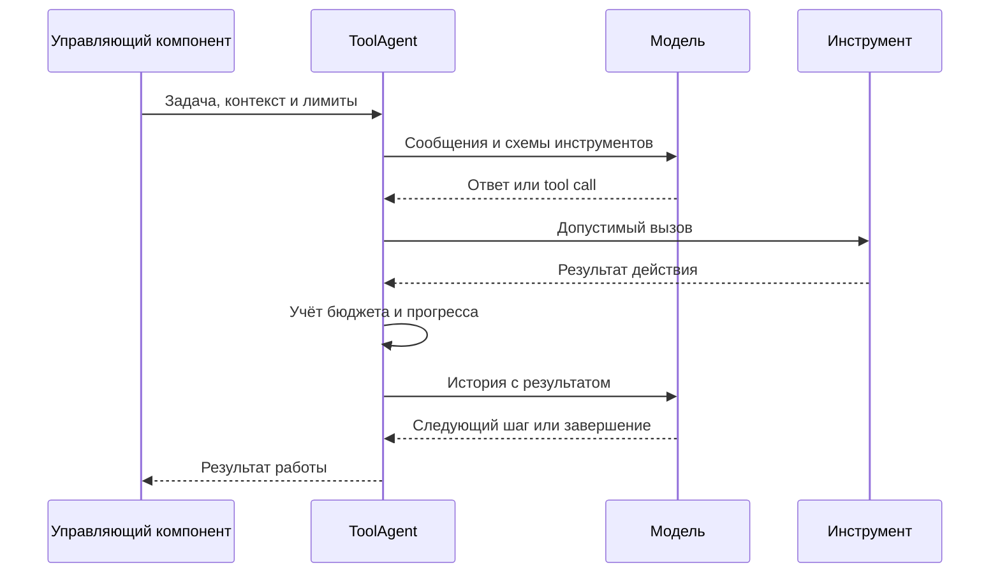

# LLM, инструменты и контекст

[Обзор проекта](../README.md) · [Презентация PDF](../presentation/Game-Factory-v4.pdf) · [Архитектура](ARCHITECTURE.md) · [Проверки и методика](VALIDATION.md)

## Назначение модельного слоя

Модельный слой обслуживает разбор запроса, дизайн, планирование, генерацию, исправление и анализ результата. Им нужны разные инструкции, источники и инструменты. Единый интерфейс клиента позволяет управляющим компонентам выбирать профиль, не встраивая детали провайдера в каждую операцию. Конвейер и чат используют общую инфраструктуру через собственные управляющие компоненты.

OpenAI-compatible API описывает форму взаимодействия. Совместимый endpoint не гарантирует одинаковое поведение серверов: различаются JSON-режимы, tool calling, ошибки и наличие счётчиков токенов.

## Профиль, роль и стадия

**Профиль** описывает конкретное подключение и параметры. **Роль** обозначает характер работы. **Стадия** определяет её место в конвейере.

В маршрутизируемом режиме явное назначение стадии имеет приоритет перед назначением роли, затем применяется настройка по умолчанию. Фильтры учитывают доступность профиля и допустимый тип задачи.

| Режим | Принцип |
| --- | --- |
| single | Политика одного выбранного подключения без автоматического ансамбля |
| multi | Выбор по стадиям и ролям, разрешённые fallback-переходы |
| free_route | Маршрутизация с учётом совместимых API и их ограничений |

Явно закреплённый профиль строже обычного fallback: недоступность остаётся отказом выбранного маршрута. Конкретные разрешённые переходы зависят от настроек и типа задачи. Поэтому систему нельзя описывать как «при любой ошибке попробует любую модель».

## Цикл агента с инструментами

Схема показывает один повтор. Реальный цикл ограничен числом раундов и бюджетом. Доступность схемы инструмента не отменяет проверку аргументов, области проекта и политики записи.

Успешный HTTP-ответ и успешный транспорт не доказывают выполненную правку. Инструмент может вернуть отказ проверки или отсутствие изменения. Агент учитывает содержимое результата.

В маршрутизируемом клиенте первый успешный запрос закрепляет профиль для последующих раундов текущей работы. История инструментов не переносится между моделями незаметно.

## Структурированные ответы

Некоторые стадии ожидают объект с определённой структурой. Клиент учитывает совместимость формата с сервером, затем фабрика извлекает и проверяет данные.

Здесь есть три отдельных результата: сервер принял формат запроса, ответ удалось разобрать, структура удовлетворяет требованиям операции. Корректный JSON ещё может содержать неизвестный компонент, неверный ID или отсутствующую обязательную связь.

## Классификация ошибок

| Причина | Возможная реакция в разрешённом маршруте |
| --- | --- |
| Переполнение контекста | Сократить контекст и выполнить допустимую попытку |
| Некорректная структура | Ограниченно запросить исправление формата |
| Превышение частоты или квоты | Учесть охлаждение провайдера и разрешённый fallback |
| Модель не найдена | Исключить неподходящий профиль до обновления состояния |
| Ошибка авторизации | Остановить подключение или применить разрешённую альтернативу |
| Сетевой отказ | Действовать по сетевой политике без бесконечного повтора |
| Тайм-аут | Зафиксировать попытку и применить политику отказа |
| Несовместимый tool calling | Зафиксировать несовместимость и разрешённую реакцию |

Таблица не обещает fallback при закреплённом профиле и не задаёт одинаковые правила всем стадиям.

## Учёт бюджета

Бюджет относится к фактическим обращениям, включая неуспешные попытки. Измерения включают запросы модели, вызовы инструментов, диагностику и время.

Резервирование до вызова не позволяет нескольким обращениям одновременно использовать один последний свободный слот. Повторные запросы и необязательный ансамбль используют тот же общий учёт.

Если сервер предоставляет необходимые счётчики токенов, фабрика может учитывать их в метрике. Отсутствующая телеметрия остаётся отсутствующей. Длина текста не заменяет число токенов или денежную стоимость.

Предел отдельного job и расходы всей серии различаются. Несколько продолжений игрового случая суммарно могут превысить лимит одного job, не нарушая его.

## Состав контекста

В зависимости от стадии в запрос входят исходные требования, дизайн, план, инвентарь проекта, рецепт, каталог компонентов, схемы инструментов, выдержки RAG и компактная диагностика.

Источники имеют разное назначение. Требование задаёт цель, инструмент задаёт способ действия, справочная карточка предлагает подход. Справка не должна менять критерий успешности или разрешения.

Длинный результат чтения может сокращаться с явным указанием пропуска. Такой ответ является частичным просмотром. Он не подтверждает чтение строк, которые не вошли в контекст.

## Сохранение требований при доработке

Реплика «перенеси магазин вниз» дополняет установленный запрос. Она не должна стирать цены, правила выбора или условия победы.

Сценовый маршрут объединяет новую правку с исходным контрактом. Явно изменённые условия получают новую ревизию, остальные сохраняются. После отказа ожидающая просьба остаётся ожидающей.

Сокращение контекста может убрать длинный текст прежнего сценария, сохранив требования и его отпечаток. Полный сценарий QA остаётся отдельным артефактом. Краткая подсказка не становится новым эталоном проверки.

## Ансамбль

В реализации есть опциональное получение нескольких текстовых вариантов и отдельная оценка. Оно относится к разрешённым текстовым стадиям и не переносится автоматически на цепочки инструментальных правок.

Каждый worker и оценщик расходует бюджет. Несколько ответов одной модели и длина ответа не являются доказательствами качества. Наличие ансамбля не означает, что описанные игровые выпуски использовали его или получили измеренный выигрыш.

## Ограничения

Качество зависит от модели, корпуса и запроса. Контрактный отказ ограничивает последствия, но не создаёт недостающую механику. Поддержка одного endpoint не доказывает совместимость всех серверов. Локальные измерения поиска не измеряют качество генерации.
