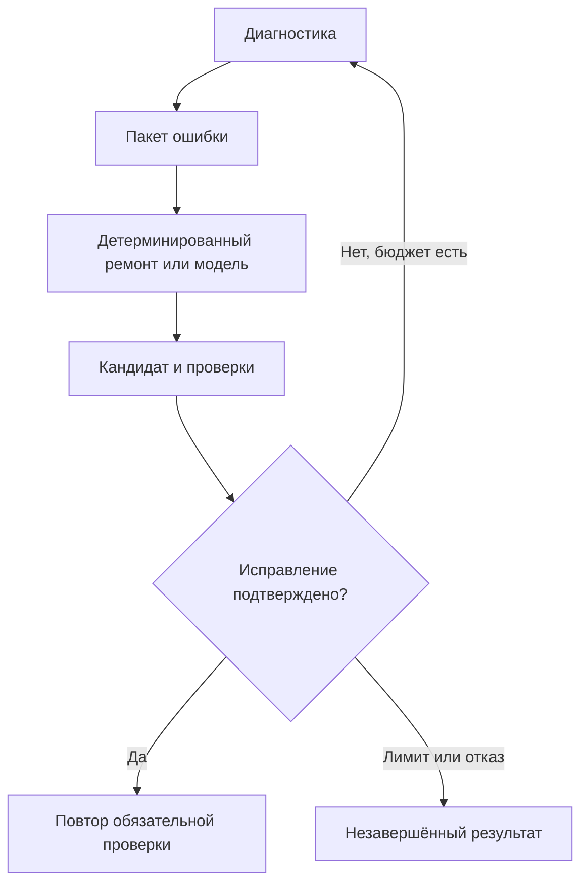
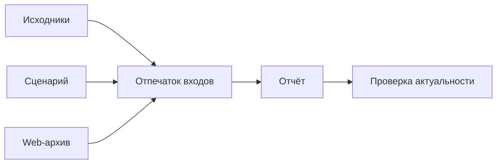

# Проверка игры и выпуск

[Обзор проекта](../README.md) · [Презентация PDF](../presentation/Game-Factory-v4.pdf) · [Архитектура](ARCHITECTURE.md) · [Проверки и методика](VALIDATION.md)

## Цель проверок

Фабрика должна выяснить, корректны ли файлы, запускается ли игра, выполняется ли проверяемая механика и соответствует ли экспорт проекту, который прошёл QA. Эти вопросы требуют разных проверок. Суммарный балл не должен скрывать обязательный отрицательный результат.

## Уровни подтверждения

Сплошные линии описывают переходы поддерживаемого Web-маршрута. Штриховые показывают обработку отрицательного результата. Экспорт и проверка архива выполняются отдельно от игровой QA.

| Уровень | Пример | Граница |
| --- | --- | --- |
| Статика | Ссылка на ресурс или допустимая структура | Не подтверждает запуск |
| Контракт | Обязательная связь совместима | Не доказывает игровой эффект |
| Импорт и запуск | Godot импортировал проект и открыл сцену | Не доказывает прохождение правил |
| Runtime | Игра активна, обязательная диагностика пройдена | Не заменяет все игровые сценарии |
| Playtest | Ввод вызывает ожидаемое действие | Ограничен сценарием |
| Browser | Проверен точный Web-архив и экраны | Не равен физическому телефону или площадке |
| Публикация | Реальный SDK и условия размещения | Требует отдельной внешней приёмки |

## Барьер ресурсов и редактора

Файлы на диске и загруженные ресурсы редактора могут находиться в разных состояниях. После генерации изображения или аудио наличие файла не доказывает, что открытый Godot импортировал его.

Соответствующий маршрут синхронизирует ресурсы до игровых проверок. Он требует привязанный проект и подтверждённую сессию. Неопределённый результат мутации нельзя безопасно считать отказом до начала записи и автоматически повторять.

Успешный scan не равен завершённому импорту, а состояние чужого редактора не подтверждает рабочий проект.

## Движение и прыжок

Сравнение двух конечных координат недостаточно: игрок мог умереть, сменить сцену или вернуться на старт. Нативная проба прыжка использует непрерывную историю физических кадров, привязанную к одному игроку и сцене.

Наблюдение должно включать исходное положение на земле, доставку ввода, реальное движение вверх и свежее подтверждение отпускания. Если доставка или наблюдение не подтверждены, результат остаётся непроверенным. Модельный отзыв не снимает такой отказ.

Область этой пробы — управление. Она не подтверждает прохождение кампании.

## Экономика и сохранения

Сценарий экономики должен знать стоимость покупки и ожидаемый эффект. Для поддерживаемых кликеров ожидания связаны с рецептом и требованиями проекта.

Проверка сохранений сопоставляет состояние до и после перезапуска или reload. Нативный маршрут использует отдельные пользовательские данные и при необходимости второй процесс. Браузерный маршрут работает с реальной Web-сборкой.

Тест метода сохранения в изолированной API-фикстуре и проверка настоящей кнопки игры с последующим восстановлением имеют разную область подтверждения.

## Ограниченный ремонт

Ремонт сохраняет критерии. Если игра должна запрещать вторую специализацию, исправление не может добиться успеха удалением запрета из ожиданий.

Повторяющаяся причина, исчерпание бюджета или подтверждённый инфраструктурный отказ останавливают цикл. При успешной правке прежний отрицательный тест не становится положительным без повторной проверки.

## Final QA и итог задачи

Final QA собирает применимые фазы, балл и сигнал технической готовности. Итоговая политика учитывает обязательные стадии и фактическую причину остановки.

| Состояние | Смысл |
| --- | --- |
| Успешная задача | Применимые требования завершения выполнены |
| Частичный результат | Проект существует, часть обязательной работы не завершена |
| Ошибка | Выполнение завершилось с отрицательным результатом |
| Отмена | Получен запрос остановки |
| Skipped / inconclusive | Отдельная проверка пропущена или не дала подтверждения |

Пропуск и неопределённый результат не равны PASS. Положительная часть отчёта не отменяет обязательный отрицательный test или реальную остановку по лимиту.

## Привязка доказательств

Если изменился сценарий, старый результат не подтверждает новый. Если изменился архив, проверка прежней сборки не переносится на новый ZIP.

При resume можно сохранить актуальную генерацию и экспорт, повторив нужную проверку. Для этого требуется проверка зависимостей, а не доверие списку завершённых этапов.

## Отрицательные контроли

Для отдельных семейств проверок есть намеренно сломанные реализации. Приёмка требует обнаружить соответствующий дефект поведения. Падение проверяющей программы до наблюдения дефекта не является успешным негативным контролем.

Такой результат подтверждает чувствительность конкретного сценария. Он не доказывает отсутствие всех дефектов.

## Локальный браузер и площадка

Playwright/Chromium проверяет ввод, экраны, reload и предусмотренные изменения ориентации. Локальное тестовое окружение SDK воспроизводит ограниченный протокол.

Площадка добавляет реальные SDK, сеть, HTTPS, MIME, iframe и настройки проекта. Эти входы требуют внешней приёмки. В описанных примерах технический `can_ship=true` сосуществует с `ship_gate=CONCERNS`.

Процент успешной генерации на произвольных запросах, коммерческий результат и работа на всех телефонах этим кейсом не установлены.
