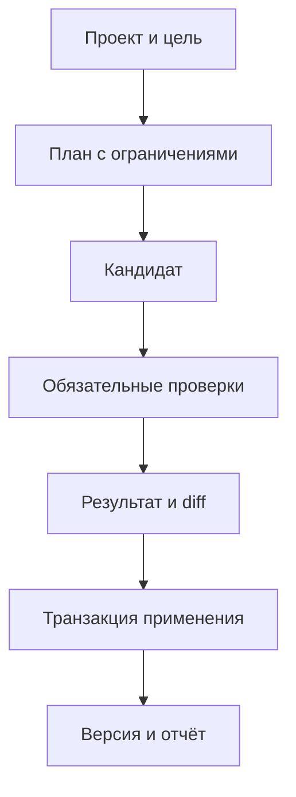

# Рабочий центр, навыки и история

[Обзор проекта](../README.md) · [Презентация PDF](../presentation/Game-Factory-v4.pdf) · [Архитектура](ARCHITECTURE.md) · [Проверки и методика](VALIDATION.md)

## Рабочий центр

Рабочий центр объединяет проекты, задачи, каталог навыков, диагностику, версии и аналитику. Пользователь начинает с выбранной игры и цели, затем изучает план и результат.

## Карточка, действие и набор

| Сущность | Назначение | Граница |
| --- | --- | --- |
| Карточка | Подход, условия применения, описание проверки | Текст не становится произвольным исполняемым разрешением |
| Действие | Зарегистрированная операция с обработчиком и контрактом | Не обещает успех на любой игре |
| Набор | План действий для пользовательской цели | Может включать разные подсистемы и проверки |

Срез от 22 октября 2026 содержит 412 карточек: прежние 112 и новые 300. Для новых карточек предусмотрены контракты. Старые неполные метаданные отражаются отдельными предупреждениями.

Выбор учитывает задачу, явное указание, жанр, этап, инструменты и совместимость. Высокий поисковый ранг не отменяет условия допуска. Недоступный инструмент не появляется из-за подходящего текста карточки.

Доставка подсказки и исполнение действия фиксируются отдельно. Receipt показывает версию карточки и контекст, но не доказывает выполнение рекомендации моделью или успешный QA игры.

## Четыре набора

| Набор | Направление |
| --- | --- |
| Мобильный платформер | Управление и поддерживаемые механики платформера |
| Надёжные сохранения | Диагностика и ограниченное изменение сохранений |
| Оптимизация слабого телефона | Измерение и проверяемая попытка улучшения |
| Подготовка выпуска | Проверки и сбор артефактов |

План показывает шаги, инструменты, ограничения и бюджет. Для обычных проектов модель может готовить ограниченные правки скриптов. Для ScenePlan действует путь плана сцен и отдельных расширений.

Ремонт сохранений не получает право менять экономику только потому, что так проще пройти сценарий. Прямое изменение библиотечного runtime не подменяет предусмотренную операцию.

## Подготовленный результат

Схема описывает этапы, а не обязательный запрос подтверждения на каждом шаге. Выполнение следует настройкам операции.

Подготовленный результат должен совпадать с применённым. Изменение исходников или внешних входов останавливает устаревшее применение. Материалы отказа помогают разобраться, что именно предложила модель и почему фабрика отказалась принять результат.

## Локальная история

Игра получает отдельное Git-хранилище вне обычного рабочего дерева. Привязка принадлежит конкретному пути. Копия не должна незаметно присвоить историю исходного проекта.

Хранятся отобранные исходные файлы и метаданные. Сборки, кэши, отчёты и прогресс игроков не становятся историей исходников. Секретные имена и типы файлов исключаются.

Перед первым изменением сохраняется исходный снимок. Внешняя правка может получить отдельный снимок, чтобы не приписывать её следующему действию фабрики.

| Операция | Значение |
| --- | --- |
| Diff | Отличия файлов между состояниями |
| Revert | Обратное изменение с сохранением независимых поздних правок |
| Merge | Проверяемое объединение в копии |
| Restore | Полное восстановление выбранного снимка отдельной операцией |

Эти операции не используют checkout/reset пользовательского дерева. Файлы переносит собственный маршрут. Конфликт сохраняет рабочую игру. После восстановления исторический QA не становится свежим автоматически: учитывается отдельная эпоха проверки.

## Аналитика

SQLite хранит события и сводки. Интерфейс показывает стадии, обращения, задержки, ошибки и доступные аппаратные измерения. События других процессов читаются из подтверждённого хвоста хранилища и не должны дублировать точки при повторной доставке.

Смена проекта меняет область данных. Кэш сводки учитывает ревизию хранилища. Скрытые графики не требуют постоянной перерисовки. Неизвестный аппаратный показатель не выдаётся за ноль.

Сбой наблюдаемости не должен останавливать полезную работу. Метрики объясняют выполнение и позволяют измерять отдельные компоненты, но не заменяют QA.

## Предложения обучения

Подтверждённый ремонт требует воспроизведения исходной ошибки и проверки конкретного изменения. Успешное добавление функции не становится ремонтом автоматически.

Предложение опирается на независимые случаи, актуальные входы и версии проверяющего кода. Повтор одного случая обновляет доказательство, но не увеличивает число независимых случаев.

При включённом требовании одобрения предложение проходит рассмотрение. Его можно изучить, изменить, объединить ссылку с существующей карточкой или отклонить. Исходный QA относится к исходной игре, а переносимость паттерна требует отдельной оценки.

## Границы приёмки

40 зарегистрированных действий имеют проверки протоколов адаптеров и отказов. Часть внешних подсистем в них подменена явными фикстурами. Настоящие Godot- и браузерные прогоны подтверждают перечисленные операции, но не всю матрицу.

Полная приёмка четырёх наборов и предусмотренных сквозных модельных маршрутов продолжается. Список кнопок и карточек её не заменяет.
